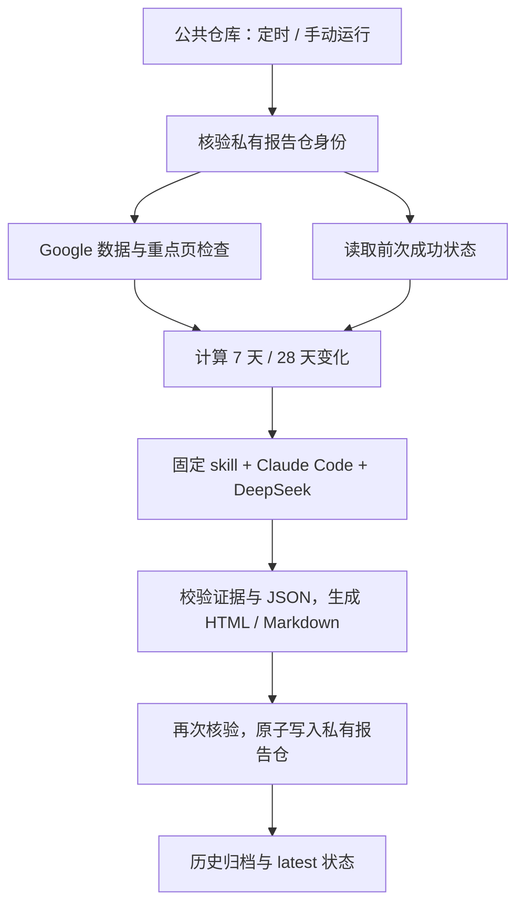

# NocoBase Growth

每天读取 `nocobase.com` 的真实搜索数据，生成一份中文增长日报。
**公共仓库保存代码与工作流；私有仓库保存报告、证据和跨日状态。**

主力数据源为 Google Search Console，GA4 可选；页面巡检使用静态 HTML。
Claude Code + DeepSeek Flash 负责解释已计算的事实，输出原因假设和最多三个
优先动作。代码计算全部数值，并校验模型输出后再归档。

## 架构



| 仓库 | 用途 |
| --- | --- |
| `gchust/nocobase-growth`（Public） | 工作流、采集器、计算规则、skill、渲染器、测试和配置模板 |
| `gchust/nocobase-growth-reports`（Private） | HTML / Markdown 报告、指标、分析、运行记录和历史状态 |

生产 job 只输出阶段状态，不向公共 artifact、cache 或日志输出业务数据。
报告仓不开启 GitHub Pages。完整 HTML 下载后查看，同时提供可在私有 GitHub
文件页直接阅读的 Markdown 版本。

## 首次配置

按 [部署说明](docs/setup.md) 完成：

1. 确认两个仓库：公共代码仓以 `main` 为默认分支；报告仓保持 **Private**，以现有的 `develop` 为默认分支。
2. 报告仓真实数字 ID `1414200278` 已写入 `sites/nocobase.json`；仅在重新创建报告仓时重新核对并更新。
3. 公共仓库的 `growth-production` 环境已建立，仅允许 `main` 分支；在其中配置
   三个 Secrets：`REPORTS_TOKEN`、`GOOGLE_CREDENTIALS_JSON`、`DEEPSEEK_API_KEY`；
   自定义模型服务时，再配置两个 Variables：`DEEPSEEK_BASE_URL`、`DEEPSEEK_MODEL`。
4. 手动运行 `preflight`，再运行一次 `report` 并核对真实数据。
5. 把仓库变量 `GROWTH_ENABLED` 设为 `true`，启用上海时间每日 **09:17** 的运行。

配置尚未完整时不会开始生产采集。GitHub 的定时任务可能延迟；若公共仓库
连续 60 天没有活动，schedule 会自动停用，需手动恢复。实现和维护说明见
[GitHub schedule 文档](https://docs.github.com/en/actions/reference/workflows-and-actions/events-that-trigger-workflows#schedule)。

## 本地验证

要求 Node.js 22.15 或以上版本；采集与渲染代码没有 npm 运行时依赖。

```sh
npm test
npm run check
npm run demo
```

演示生成在 `.work/demo/`，其数字全部为合成数据，不访问 Google、模型或
报告仓，不代表真实 SEO 效果。这些输出被 gitignore 排除。

实际本地运行需安装配置中固定版本的 Claude Code，设置上述三个环境变量
和当前代码的 `GROWTH_CODE_SHA`，再执行 `npm run report`。无人值守工作流已按
阶段隔离凭证；本地也不要把凭证写进仓库。自定义服务同样通过
`DEEPSEEK_BASE_URL` 和 `DEEPSEEK_MODEL` 环境变量配置。

## 报告内容

- 搜索点击、曝光、CTR、平均位置，最近 7 天与前 7 天、最近 28 天与前 28 天。
- 56 天趋势，以及主要页面和查询词变化；保留返回明细的覆盖限制。
- 重点页面的 HTTP、title、description、canonical、robots、H1 和跨日变化。
- 可选 GA4 自然搜索会话、去重用户及关键事件，明确属性与 hostname 范围。
- 有证据的原因假设、最多三个优先动作、数据缺口、前次报告与完整运行信息。

### 数据规则

GSC 使用 `final` 数据、Google 的 Pacific 源时区和明确的截止日期。7 天与
28 天比较均包含两端且期间等长。四段站点总量独立查询，不能通过 Top 查询词
或页面求和得到。明细中没有观察到的行与缺测日期保持未知；不会伪造成 0。
GSC API 本身不保证返回全部明细，详见
[Search Analytics 文档](https://developers.google.com/webmaster-tools/v1/searchanalytics/query)。

GA4 使用独立区间总量，避免把每日去重用户相加。GSC 域名属性可包含子域，
GA4 hostname 范围可能不同，报告保留各自口径。GA4 没有 GSC 式的 `final`
参数；其数据仍可能后续修订，详见
[GA4 数据新鲜度](https://support.google.com/analytics/answer/11198161?hl=en)。

模型只能填写 `insights`，不得修改指标；引用必须属于已有证据，目标 URL
必须属于已配置域名。HTML 和 Markdown 对外部内容进行转义，不加载远端脚本、
字体或图片。未配置 GA4 会生成明确受限的报告；已配置数据源发生错误时，
保留失败/受限记录，不能推进成功状态。

### 历史与失败

私有报告存于 `runs/报告日期/运行ID-重试次数/`，每次最多六个白名单文件。
成功状态保存在 `state/latest.json`、`state/summary.json` 和
`state/site-checks.json`。只有更新报告日期且不使用更旧数据的成功运行才能
原子更新状态；同日重跑和旧数据补跑均保留独立历史。

生成失败不覆盖成功状态。发布失败先重试已经生成的文件，不再次调用模型；
写入冲突使用非强制更新并有界重试。无法确认目标私有时停止，不能回退到公共存储。

## Skill 与模型

项目日报规则位于 `.claude/skills/nocobase-growth-daily/SKILL.md`。
参考的 `claude-seo` **v2.4.2** 两份 skill 已固定到提交
`4b99de2f7de7e7d5247042e5fb5b4ea9368ef734`，保存在 `vendor/claude-seo/`；
保留其 MIT 许可和来源记录。运行时只加载需要的参考段落，不执行上游安装器
或完整审计脚本。

Claude Code 固定 **2.1.296**，使用 `--bare`，禁用工具与 MCP，显式读取
日报规则。`DEEPSEEK_BASE_URL` 和 `DEEPSEEK_MODEL` 可覆盖站点文件中的默认
endpoint 和模型 ID；未设置时使用 `https://api.deepseek.com/anthropic` 与
`deepseek-flash`。全部 Claude 模型别名使用本次配置中的同一个 ID。

自定义 endpoint 必须为 HTTPS，并提供 Claude Code 所需的 Anthropic Messages
兼容协议；只有 OpenAI Chat Completions 接口的地址不能直接替代。应填写服务商
提供的 Base URL 和精确模型 ID，Key 保存在 Secret 中，不写入 URL。
本次配置在准备阶段保存，模型输入包含报告所需的业务指标与页面证据，会发送到
所选服务。模型输出在本地通过闭合 schema 校验，不依赖提供商原生 JSON Schema 支持。

[Claude Code 程序化运行](https://code.claude.com/docs/en/headless) ·
[DeepSeek 集成说明](https://api-docs.deepseek.com/quick_start/agent_integrations/claude_code/) ·
[claude-seo 上游](https://github.com/AgriciDaniel/claude-seo)

## 项目结构

| 目录 / 模块 | 职责 |
| --- | --- |
| `.github/workflows/` | 无凭证 CI，以及生产定时 / 手动流程 |
| `src/google.mjs`、`src/metrics.mjs` | 可刷新的 Google 身份、数据采集和确定性计算 |
| `src/technical.mjs` | 有限重点页静态检查及历史比较 |
| `src/analyze.mjs`、`src/validate.mjs` | Claude 进程隔离、输出与证据校验 |
| `src/render.mjs` | 自包含 HTML 与安全 Markdown |
| `src/archive.mjs`、`src/pipeline.mjs` | 私有目标核验、阶段协调和原子历史归档 |
| `sites/`、`schemas/` | 站点与输出契约 |
| `tests/` | 模拟提供方、失败、隐私和完整阶段验证 |

首版不包含付费排名服务、竞争对手抓取、实际 AI 引用监控或自动修改网站；
需要新增数据源时，沿用明确口径、证据和私有归档的接口。
