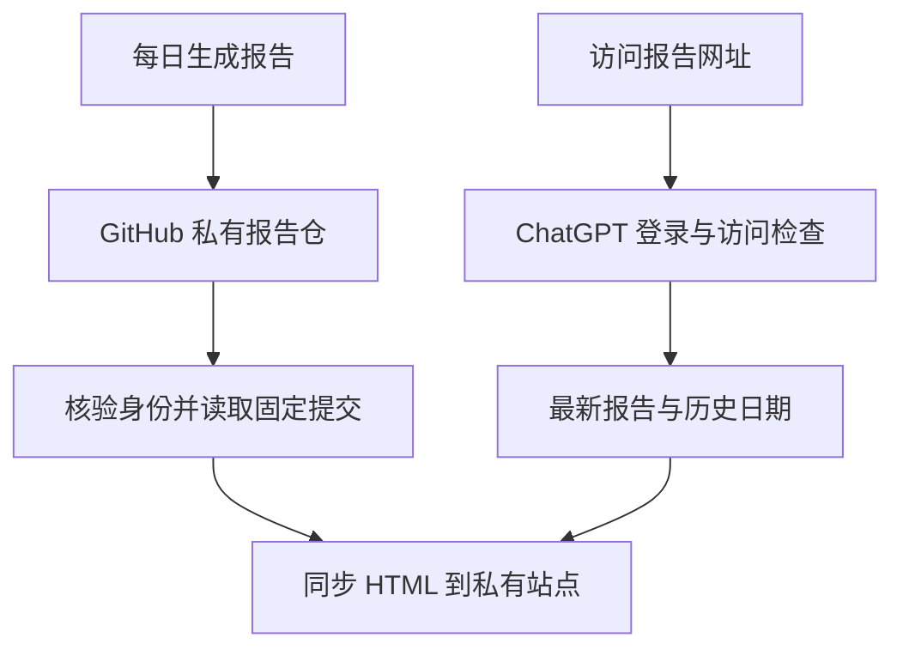

# 私有 HTML 报告网页

报告网页：https://nocobase-growth-reports.gong-ads.chatgpt.site

使用站点所有者的 ChatGPT 账号登录后，可直接阅读最新 HTML 报告、选择历史日期、刷新或下载。网页保留最近 365 次同步的目录；GitHub 私有仓库继续保存完整原始归档。

## 自动更新

`NocoBase growth report` 成功后触发 `Publish private HTML report`。同步工作流从核验过的私有仓库读取最新成功报告，不再次采集页面、不调用模型。同步失败可单独重跑；已写入 GitHub 的报告不会丢失。手动运行同步工作流也可发布已有报告。

同一报告重复同步不会重复保存；同一个运行标识不能被不同内容覆盖。历史回填、同日重跑以及 Google 截止日期倒退不会替换已有最新报告。

## 配置

以下值位于公共代码仓库的 `growth-production` 环境：

| 类型 | 名称 | 用途 |
| --- | --- | --- |
| Variable | `REPORT_VIEWER_URL` | 已配置的私有站点 HTTPS origin |
| Secret | `REPORT_VIEWER_TOKEN` | 仅用于该站点的服务访问凭证 |
| Secret | `REPORTS_TOKEN` | 现有 GitHub 私有归档访问凭证 |

GitHub 凭证只发送到 `api.github.com`；站点凭证只发送到已配置的固定站点。模型与 Google 凭证不参与同步。两个请求路径都拒绝重定向，不把响应正文或凭证写入公开日志。

## 源码与数据

`viewer/` 保存查看器程序源码。网页在 Sites 的 Cloudflare Workers 上运行，R2 绑定为 `BUCKET`，只缓存 HTML 和查看目录。真实报告、模型分析及 R2 运行数据不得混入公开源码或部署源代码快照。

站点必须保持 **仅所有者可访问**。浏览器通过 ChatGPT 登录，GitHub Actions 通过站点服务凭证访问。服务访问在应用外层由 Sites 验证；应用接口不得作为公开 Worker 部署。读取返回 `private, no-store`；报告在禁止脚本的 iframe 内展示，完整 HTML 响应同样有严格 CSP。

普通个人仓库的 GitHub Pages 不提供同样的私有访问控制，因此这里使用受登录保护的站点。不要把 HTML 同步到公共 Pages、公开对象存储或公开 Actions artifacts。

查看器源码变动需要重新部署；每天新增报告只更新私有运行数据，无需重新构建站点。
